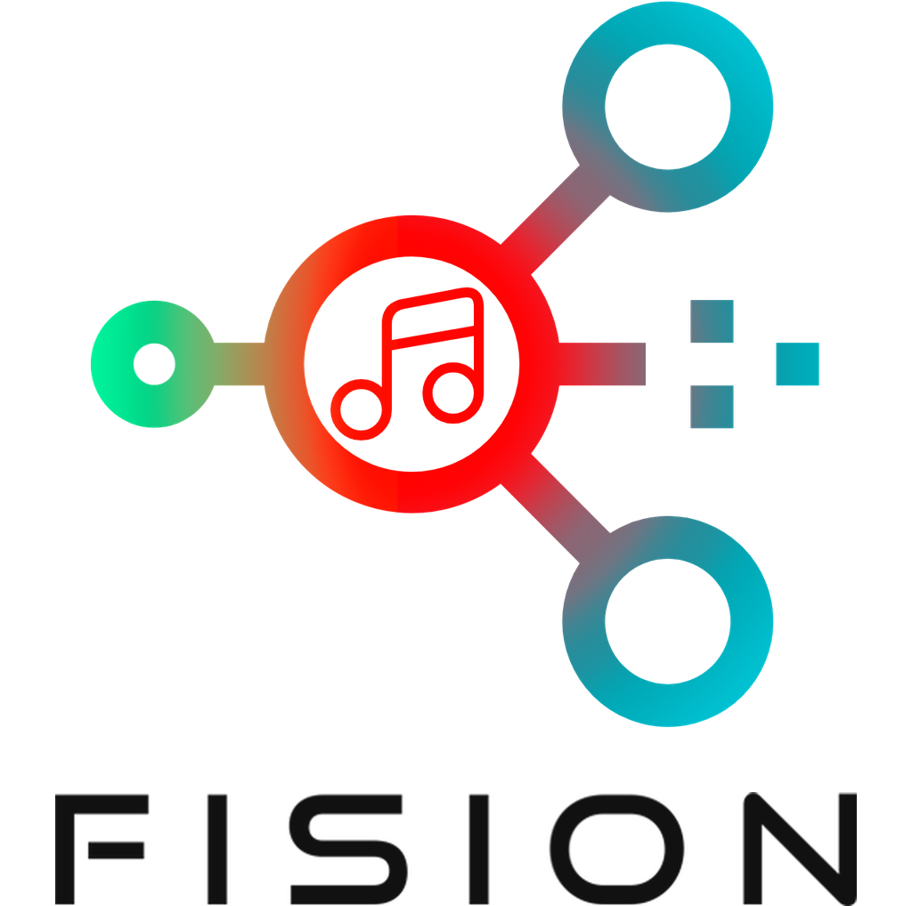
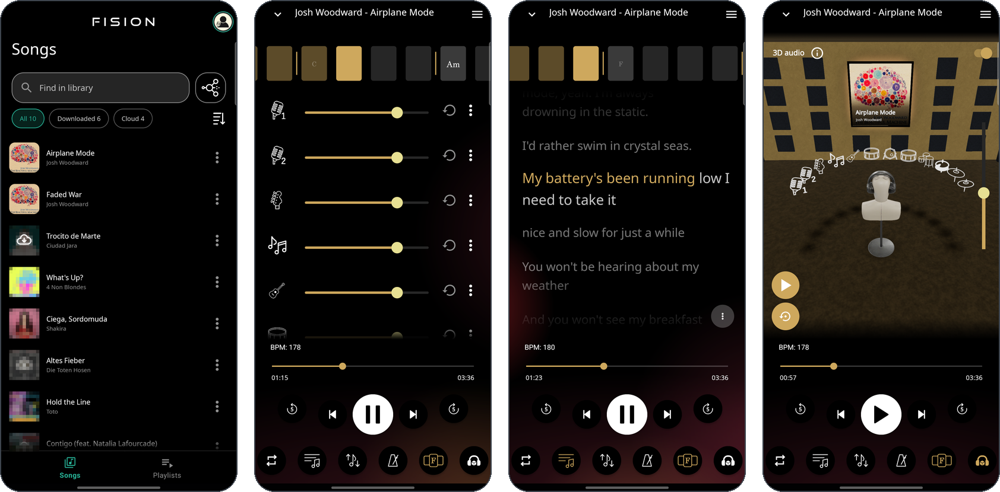
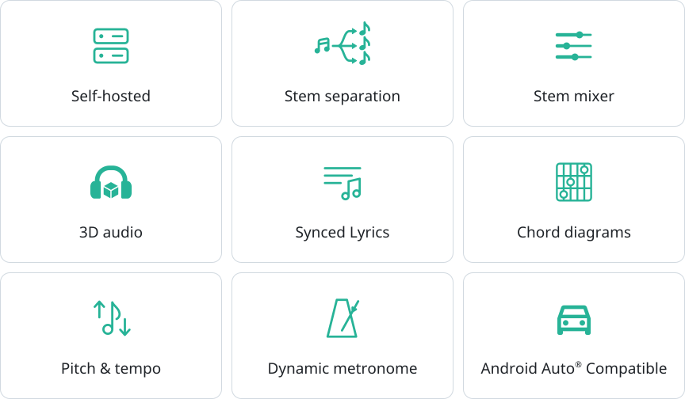
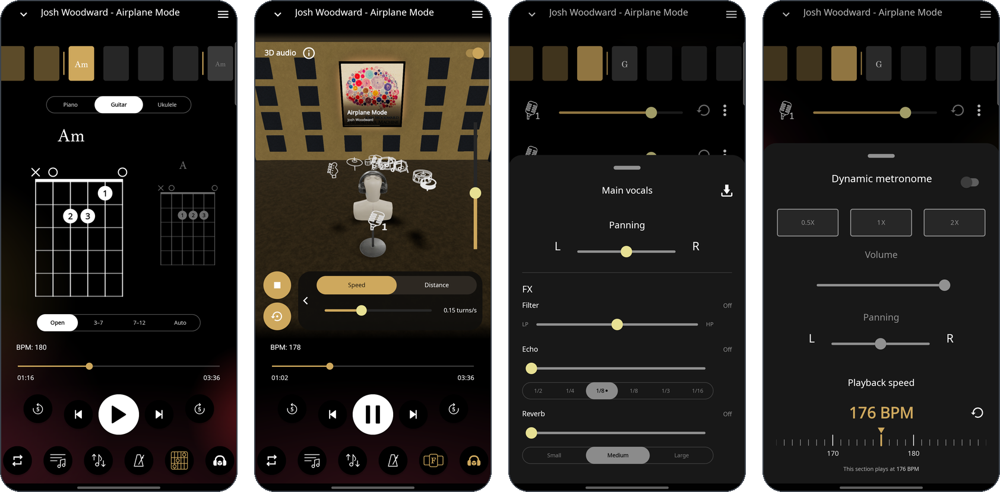
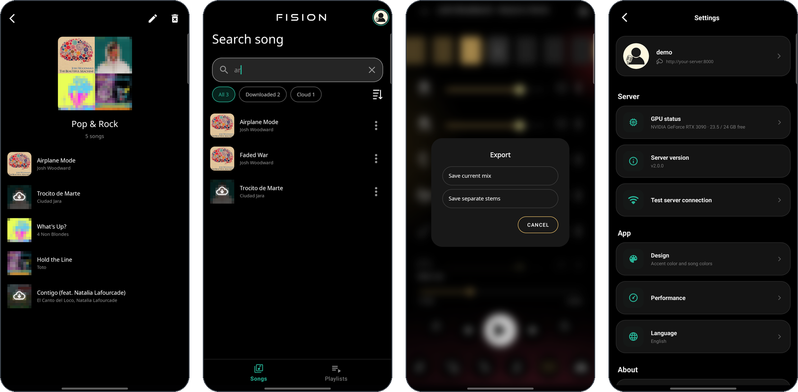
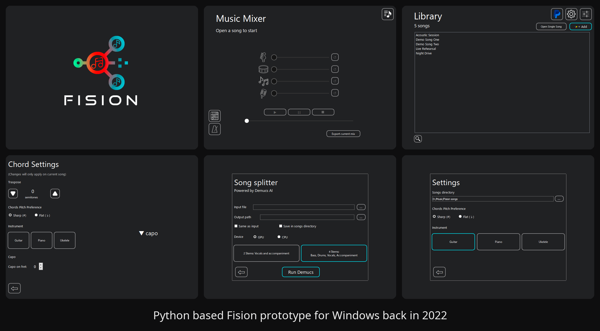
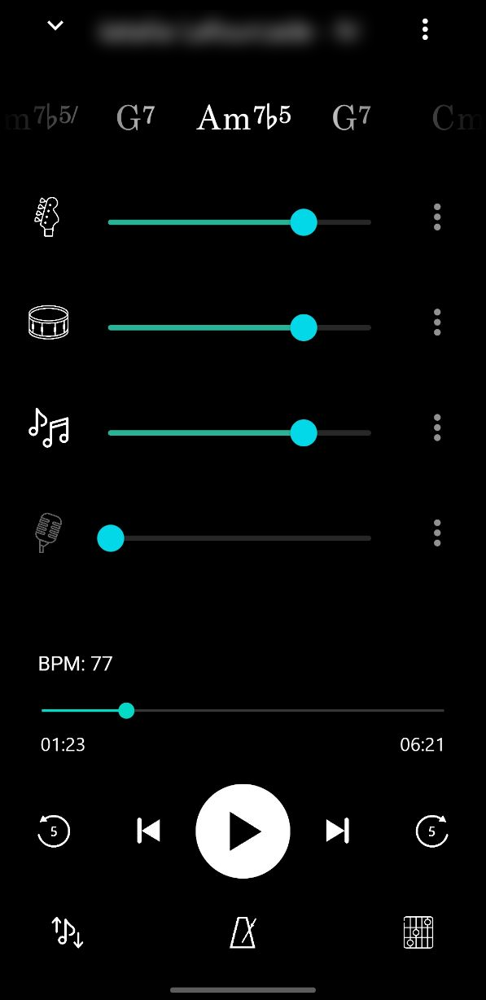
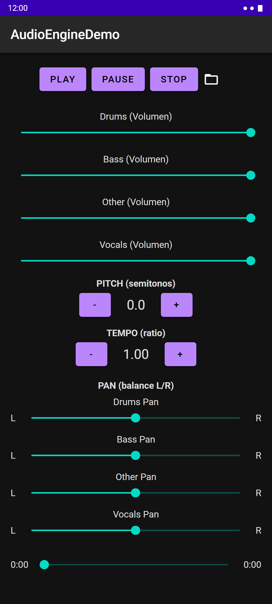

  <picture>
    <source media="(prefers-color-scheme: dark)" srcset="./docs/screenshots/title_dark.png">
    
  </picture>
  
<b>The magic starts with the fision of your music.</b>

  

    
    
    
    
    
  

Fision is a self-hosted stem player. You just send a song to your
[FisionServer](https://github.com/jotapemj/Fision-Server), it comes back as separate
stems with chords, beats and lyrics, and this app plays them through a native
engine where every stem can be mixed, effected and even placed in 3D space.

 

  

 

## Features

  <picture>
    <source media="(prefers-color-scheme: dark)" srcset="./docs/readme/features-dark.svg">
    
  </picture>

## Also

* **Stem effects**: filter, tempo-synced echo and reverb on each stem.
* **Export** the mix or each stem to WAV, AAC or M4A.
* **Playlists** stored on your server, playable offline.
* **Chord notation** in American or Latin, with sharps or flats, transposed with the pitch.
* **Background animation** with optional haptics on tempo.
* **Share song to Fision** compatible.
* **Local mode** to play song folders without a server.
* **10 languages**

<b>More screenshots</b>

 

  
    
  

## Getting started

1. Run a [FisionServer](https://github.com/jotapemj/Fision-Server) on a computer you
   control, ideally reachable through Tailscale or HTTPS.
2. Build and install the app (see [Building](#building)). It needs Android 8.0
   or newer.
3. Sign in with the server address and your account, add a song and pick how
   to separate it.

The [user guide](docs/GUIDE.md) walks through every screen, and the
[technical notes](docs/TECHNICAL.md) cover the engine and the song format.

## Building

A standard Android Studio project with Gradle, plus the Android NDK and
CMake for the C++ engine. Open it in Android Studio, let Gradle sync and run
the `app` configuration on a device with Android 8.0 (API 26) or newer.

## A bit of history: road to Fision

Fision is a project I have been thinking about since 2020, when the **Demucs** and **Spleeter** audio separation models first came out. When I discovered those models, I was fascinated by the idea that a song could be separated into different instruments, or turned into an instrumental track with almost no artifacts (you could still hear some back then, but to me it was amazing). My knowledge of Python, patience, and some free time allowed me to build a prototype of what **I had in mind**: a player that would let me remove instruments in real time and display chords for backing tracks. That’s how the first Fision prototype came about, which initially went by other, more primitive names, such as *“AIMS”* (*Artificial Intelligence Music Separator*) or, later on, *FisionAI*.

<b>Fision timeline</b>

**2020: first experiments.** Demucs and Spleeter running on a laptop
GTX 1050, with the separated stems mixed by hand in a DAW.

**2022-2023: FisionAI.** A desktop app in **Python** and **Qt**: a song library, a four-stem mixer, **Demucs** separation on the GPU, beats and chords first with **Chordino** and later with **madmom**, a metronome at half, normal and double speed, and chord diagrams for guitar, piano and ukulele. **Changing pitch or tempo live** was out of reach for me at that time.

  

**2023: first Android app.** I ported the logic of the Python program to Android. It was a primitive first version. No server at all: everything offline, with the song folders copied straight to the phone (the origin of today's local mode), and one `MediaPlayer` per stem. Keeping those players in sync was a constant headache.

  

**2024: AudioEngineDemo.** The first Android test of a native engine with
Oboe and SoundTouch: four stems in sync with volume, pan, and live pitch and tempo. That was the turning point, as it became the core of the current engine. No more MediaPlayer.

  
  
Oboe audio engine demo app for testing.

**Today: Fision.** The engine grew into the app, and the Python pipeline
moved to FisionServer.

## Thanks

> Fision is a personal project I have been working on slowly for years, and one
> I hold dear. I am proud to have finally reached the project I had been dreaming about for so long.
>
> Thanks to everyone who had the patience to listen to me, test the app and suggest improvements. Thanks as well to today's LLMs, like Claude, which helped me a lot with the hardest parts, such as server communication and maintenance.
>
> If this project is useful to you, a star, an issue or an idea means a lot.
> Thank you.

## Credits

Fision builds on these projects. Please respect their licenses if you reuse
code from this repository.

**Audio**

- [Oboe](https://github.com/google/oboe): low-latency audio. Apache 2.0.
- [SoundTouch](https://www.surina.net/soundtouch/): pitch and tempo. LGPL 2.1.
- [dr_flac](https://github.com/mackron/dr_libs): FLAC decoding. MIT-0 / Public Domain.
- [KEMAR HRTF measurements](https://sound.media.mit.edu/resources/KEMAR.html),
  MIT Media Lab: free with no restrictions on use, citing the authors.

  > Gardner, W. G., and Martin, K. D. (1995). "HRTF measurements of a KEMAR."
  > Journal of the Acoustical Society of America, 97(6), 3907-3908.

**App**

- AndroidX, Material Components, Room, OkHttp, Retrofit and Gson: Apache 2.0.
- [Filament](https://github.com/google/filament) and
  [SceneView](https://github.com/SceneView/sceneview-android): 3D scene. Apache 2.0.
- Listener head model of the 3D scene, generated with [Meshy](https://www.meshy.ai).
  [CC BY 4.0](https://creativecommons.org/licenses/by/4.0/).
- [chords-db](https://github.com/tombatossals/chords-db): guitar and ukulele
  chord shapes. MIT.
- [Noto Sans](https://github.com/notofonts/latin-greek-cyrillic) and
  [MusGlyphs](https://www.notationcentral.com/product/musglyphs/): fonts. SIL Open Font License.
- [Material Icons](https://fonts.google.com/icons): car icon of the feature
  grid. Apache 2.0.

**Demo song and screenshots**

- "Airplane Mode", the demo song FisionServer adds to every new account, and
  "Faded War", both by [Josh Woodward](https://www.joshwoodward.com) with the
  cover of the album *The Beautiful Machine*.
  [CC BY 4.0](https://creativecommons.org/licenses/by/4.0/). Stems, chords,
  beats and lyrics are derived from the recordings. Other covers in the
  screenshots are pixelated.

**Server pipeline** (runs on FisionServer, listed for attribution)

- Demucs and BS-RoFormer (via audio-separator): stem separation.
- BTC (Bidirectional Transformer for Chord recognition): chords.
- beat_this: beats and downbeats.
- Whisper (via faster-whisper): lyrics transcription.

Android Auto is a trademark of Google LLC.

## License

Copyright (C) 2026 Jotapeveloper

Fision is free software: you can redistribute it and/or modify it under the
terms of the [GNU General Public License](LICENSE) as published by the Free
Software Foundation, either version 3 of the License, or (at your option) any
later version. Any work based on it must keep this notice and be released
under the same license.

Third-party components keep their own licenses (see [Credits](#credits)).
The KEMAR HRTF data is free to use, including commercially, provided its
authors are cited.
