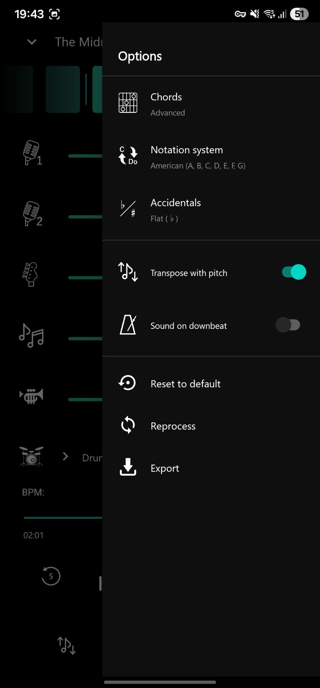

# Fision Android

<div align="center">
  <picture>
    <source media="(prefers-color-scheme: dark)" srcset="./docs/screenshots/title_dark.png">
    
  </picture>
</div>

Android client for the Fision ecosystem. Plays multitrack songs prepared by the
Fision server as separate stems (vocals, drums, bass, other, and any extras the
server exposes) and lets you remix them, transpose, retempo, follow chord
charts, run a dynamic click, and place each stem in 3D space around the
listener.

## About the Fision ecosystem

Fision is a self-hosted setup for musicians and music lovers who want to turn
any track into a playable, remixable session. The umbrella repository at
[jotapemj/Fision](https://github.com/jotapemj/Fision) lists the pieces that make
up the ecosystem. In short:

- **FisionServer**: FastAPI service that runs audio separation, chord
  detection, beat and downbeat estimation, and packs everything into a
  ZIP consumed by this app.
- **FisionApp Android** (this repository): the Android front-end. Uploads
  audio, tracks the processing job, downloads results, and plays them back
  through a native C++ engine.

The magic starts with the fision of your music.

## Features

- Native multitrack player with sample-accurate stem mixing.
- Real-time pitch shift and tempo change.
- Chord charts synced to bars and downbeats, in American or Latin notation,
  with flats or sharps.
- Chord diagrams for piano, guitar and ukulele, showing the current and the
  next chord in sync with the song.
- Per-song synchronized lyrics powered by server-side Whisper transcription,
  with 27 language options plus automatic detection.
- Dynamic metronome that follows the song's own beat grid.
- Per-song stem panning and volume, remembered across launches.
- Per-stem effects: sweepable low-pass / high-pass filter, tempo-synced
  echo and a reverb send with three room sizes.
- Downbeat click with configurable sample.
- 3D audio positioning per stem using HRTF convolution.
- Cloud processing: pick a local file, choose the separation model, and get
  the stems back automatically.
- Multi-user server access with signed sessions and per-account profile
  avatar. Local-only mode is available for offline use.
- Song library with sort, search, edit, and delete.
- Playlists stored on the server, with custom or automatic mosaic covers
  and an offline copy for playback without connection.
- Share an audio file from any app straight into the separation picker.
- Android Auto support with a default mix and temporary karaoke and
  backing-vocals toggles.
- Interface in English, Spanish, Catalan, Ukrainian, Brazilian Portuguese,
  French, German, Italian, Russian, and Simplified Chinese, selectable per
  app or following the system language.
- Repeat modes (off, all, one) and continuous playlist that advances to the
  next song when the current one ends.
- Reprocess a song on the server with a different separation setup without
  losing its position in the library.
- Optional animated ambient background driven by the current song's cover
  palette, pulsing softly on every beat. Optional beat-synced haptic
  pulses that let you feel the tempo without looking at the screen.
- Export the current mix or individual stems to WAV, AAC, or M4A.
- Background playback with Bluetooth and notification controls.

## The song library

<div align="center">
  
</div>


The main screen lists every song stored locally plus any
song that lives on the Fision server. Each entry shows its cover, title,
and artist. Server-only songs appear alongside local ones ordered by
submission date. Songs currently being processed show a spinner over the
cover with a status subtitle. Songs being downloaded show a wave
animation over the cover growing from bottom to top.

### Importing a song

<div align="center">
  
</div>

The import flow lets you pick any audio file on the device through the
system picker and choose the separation configuration to send to the
server. There are two paths:

- **Classic presets**: 2-stem or 4-stem separation.
- **Personalized**: enable or disable individual stems (guitar, bass,
  drums, piano, brass) and choose voice mode (single or split).

The compute device is decided automatically from the server's
capabilities. On launch the app queries the server for its GPU state
and caches the result. If a CUDA GPU is available the job runs on it;
otherwise the import screen shows a warning banner explaining that
processing will fall back to CPU and take longer. While the server
info is being fetched, the send button is disabled behind a loading
overlay so no request is issued with a wrong device value.

Audio files can also be sent from other apps through the system share
sheet: choosing Fision opens this screen with the shared file already
selected, ready to pick the separation configuration.

The audio is streamed to the server without loading the whole file
into memory, and a progress dialog shows the upload percentage with a
cancel button.

Chord detection on the server always uses BTC (Bidirectional
Transformer for Chord recognition), so there is no chord backend
selector in the app.

### Server connection

<div align="center">
  
</div>

Access to the Fision server is authenticated with a username and
password. On the first launch the app shows a login dialog with an
option to continue in local mode, which lets the player run entirely
offline. Once signed in, the returned session token is stored in an
encrypted preferences file and the connection status icon in the
toolbar reflects reachability in real time.

The Settings screen exposes an Account row that surfaces the current
session and lets the user:

- **Change password**: gated by biometric authentication, then a small
  dialog with old, new, and confirmation fields. The server rotates the
  session token on success.
- **Switch account**: logs out and reopens the login dialog with the
  URL pre-filled.
- **Log out**: wipes the token and local cache for the outgoing user
  and drops the app into local mode.

A dedicated test button pings the server with a 5 second timeout and
reports success or failure. A GPU status row surfaces whether the
server exposes a CUDA device, along with the GPU model and VRAM
budget. Tapping the row refreshes the cached value on demand.

### Profile avatar

Each account can upload a profile picture. From the Account dialog, a
pencil badge on the avatar opens the system gallery picker. The app
applies the picture's EXIF orientation, opens a full-screen circular
crop view with pinch to zoom and drag to pan, and uploads the result
(512×512 JPEG) to the server. The avatar is cached locally per user so
the toolbar shows it immediately after the next launch, and it is
wiped on logout so that switching accounts always starts from a clean
state.

### Cloud processing states

While the server is working, the corresponding song entry cycles through
these states in the UI:

- **Queued**: waiting in the server queue. The subtitle shows the queue
  position when known.
- **Running**: the server is processing.
- **Waiting for GPU**: the job asked for CUDA but the GPU is currently
  busy with another process. The subtitle reflects the wait and the
  spinner is tinted differently so it is easy to distinguish from a
  regular queue slot. If the GPU stays busy for ten minutes the
  server aborts the job and the app opens a retry dialog that
  re-submits the same configuration in one tap.
- **Downloading**: the ZIP is being fetched, with a percentage overlay
  and a wave animation on the cover.
- **Cloud only**: available on the server, not yet downloaded. Tap to
  download.
- **Local and cloud**: available on the device and on the server.
- **Local only**: on the device only. Songs you added manually behave
  this way.
- **Error** or **Cancelled**: shown as a static overlay with a status
  label.

Downloads run inside a foreground service with its own notification, so
they survive leaving the app.

### Song bottom sheet


Long-pressing a song opens a bottom sheet with the cover in HD, the
title, the artist, and two actions:

- **Edit info**: opens the edit dialog described below.
- **Delete**: removes the song. If the song exists both locally and on
  the server, the local files are removed and the entry stays as
  cloud-only. A second delete pass removes it from the server too.

### Edit info dialog

<div align="center">
  
</div>

The edit dialog lets you rename the song, set the artist, and shows a
read-only information block with details of the underlying files:

- Date added.
- Audio format (WAV, FLAC, or both).
- Total size on disk.
- Duration.
- Number of stems detected.

### Playlists

The main screen has two tabs: Songs and Playlists. Playlists live on the
Fision server and are mirrored locally, so they can be played without a
connection; creating, editing, and deleting require the server to be
reachable. Each playlist has a title, an ordered list of songs that can
be rearranged by dragging, and an optional square cover. Without a
custom cover, a mosaic is built from the covers of its first songs.
Opening a song from a playlist makes the previous and next controls,
autoplay, and the mini player follow the playlist order.

### Sort by

The list can be sorted by date added, ascending or descending. The
preference is remembered and reused by the mini player when the user
swipes to the previous or next song.

### Search

The search bar filters the list by folder name, display title, and
artist. Any local metadata written by the server or edited from the app
is used as a match target.

## Player


The player screen is the main working surface. While a song loads (on
open or when changing songs) a black curtain shows the animated Fision
mark; the stems are decoded in the background, so the animation never
freezes, and playback starts as the curtain lifts. From top to bottom and
side to side you find:

- **Chord section with bars**: a horizontal strip of beat cells that
  scrolls in sync with the song. Each cell shows the chord that plays at
  that beat when available. Bar lines are drawn at each downbeat. Elapsed
  beats keep a subtle tint, with a stronger trail over the last bar.
  Tapping a cell jumps the song to that beat; dragging the strip browses
  ahead or back without jumping, and it returns to the current beat on
  its own shortly after release.
- **Stem controls**: one row per stem, with an icon that toggles mute,
  a volume slider, a restore button that animates the slider back to
  the default value, and a menu button that opens the stem bottom
  sheet.
- **Playback controls**: play and pause, seek bar, previous and next
  song buttons, and 5 second jump buttons. The previous button rewinds
  to the start of the current song when the position is past a short
  threshold, otherwise it jumps to the previous song.
- **Repeat button**: cycles through off, repeat all, and repeat one.
  Its icon and tint change to reflect the active mode.
- **Pitch button**: opens the pitch bottom sheet.
- **Metronome button**: opens the dynamic metronome bottom sheet.
- **Chords button**: unfolds into a small pill with two entries. The
  bottom one shows or hides the chord section to give the stem list more
  room. The top one opens the chord diagrams view: the current chord and
  the next one drawn for piano, guitar or ukulele, with a fret zone
  selector (open, 3-7, 7-12 or automatic) for the fretted instruments.
  Guitar and ukulele shapes come from chords-db (MIT). Swiping the
  diagrams jumps to the next or previous chord. While the diagrams are
  open, the button closes them.
- **Lyrics button**: opens the lyrics overlay for the current song.
- **Audio 3D button**: switches into the 3D positioning view.

## Song folder layout

Each song lives in its own folder inside the app's `Songs/` directory
on external storage. Folders downloaded from the server are named
after the hash the server assigns; folders you add manually can use
any name, and the app treats them as local-only.

A typical folder contains:

```
SongName/
├── bass.flac
├── drums.flac
├── other.flac
├── vocals.flac
├── (extra stems the server may produce, such as guitar, piano,
│    brass, kick, snare, toms, hh, ride, crash, vocals2)
├── metronome.flac
├── metronome_half.flac
├── metronome_double.flac
├── chords.txt         (advanced chord chart, one "CHORD TIME" per line)
├── chords_basic.txt   (optional, basic variant of the chord chart)
├── beats.txt          (first line: global BPM, then one beat time per line)
├── downbeats.txt      (optional, one downbeat time per line)
├── metadata.txt       (optional, "Title: ...", "Artist: ...")
└── artcover.png       (optional, HD cover for the notification and UI)
```

Stems can be WAV instead of FLAC (see the note above about stem
formats). The app matches stems by filename (case-insensitive, without
the extension) against its internal catalog, so any WAV or FLAC whose
name matches a known stem name is loaded automatically. Files that do
not match a known stem are ignored.

### Files securities

If a song is missing `chords_basic.txt`, the drawer disables the
Chords toggle and the advanced variant is used by default. If a song
is missing `downbeats.txt`, bar lines are inferred from the beat grid
using the global BPM. If a song is missing `metadata.txt` or
`artcover.png`, the folder name is used as the title and a generic
cover is shown.

## Audio engine

The audio engine is written in C++ and built on top of
[Oboe](https://github.com/google/oboe), Google's low-latency audio
library for Android. A single audio stream drives all stems, which means
every stem is mixed sample by sample in the same callback and therefore
always in phase.

Pitch shifting and tempo change use
[SoundTouch](https://www.surina.net/soundtouch/) (LGPL) with its WSOLA
algorithm. To keep every stem in phase when the user changes pitch or
tempo, SoundTouch runs on every stem all the time, even when the pitch
and tempo are at defaults. This avoids the phase drift that would appear
if some stems went through WSOLA and others did not.

FLAC decoding is handled by
[dr_flac](https://github.com/mackron/dr_libs/blob/master/dr_flac.h)
(MIT / Public Domain).

### Stem file format

By default stems are stored as FLAC. The server transcodes its output
to FLAC before packing the ZIP, so downloads land as `bass.flac`,
`drums.flac`, and so on. The app also accepts stems in WAV, in case the
server is configured to skip the FLAC pass. WAV files are lossless too
but roughly five times larger than the FLAC equivalent. WAV is useful
when the source is already high quality and disk space is not a
concern. It brings no benefit when the input is a lossy MP3.

## Player drawer

<div align="center">
  
</div>

The drawer on the right side of the player exposes global and per-song
options.

- **Chords**: switches between the basic and the advanced chord chart
  when the song was processed with both variants. Disabled when only
  one variant is available.
- **Chord notation**: American (C, D, E) or Latin (Do, Re, Mi). This
  also swaps the font used to render the chord glyphs.
- **Accidentals**: displays sharps or flats when transposing.
- **Transpose with pitch**: when enabled, the chord chart is transposed
  in real time to match the current pitch shift.
- **Sound on downbeat**: adds a click on the first beat of each bar.
  When enabled, a submenu lets you pick which sample to use for the
  click.
- **Play next song when this one ends**: continues playback with the
  next song in the library when repeat is off. The order follows the
  main list sort preference.
- **Animated background**: fades in an ambient nebula effect behind the
  player. Colours are derived from the current cover art and pulse on
  every beat. See the section below.
- **Reset to default**: returns the whole song to its defaults: every
  stem volume to 75 and pan to 0 (leaving solo mode), pitch 0, tempo 1x,
  metronome off with its default settings, and 3D audio off.
- **Reprocess**: reopens the import activity prefilled with the current
  configuration and lets you re-run the pipeline on the same input
  file with different options. When the server finishes, the new ZIP
  replaces the old stems on disk.
- **Export**: opens the export wizard. You can export the current mix
  or the stems individually. Supported formats are WAV (PCM 16 stereo),
  AAC (raw with ADTS headers), and M4A (AAC LC in an MP4 container).
  When exporting the mix, the metronome and the current stem volumes
  can be included optionally.

## Stem bottom sheet

Tapping the menu button on a stem opens its bottom sheet. From here you
can:

- Set the stem pan from left to right.
- Solo or unsolo the stem.
- Export the stem on its own, choosing the target format.
- Shape it with effects:
  - **Filter**: one bipolar slider. Left sweeps a low-pass filter down from
    20 kHz to 200 Hz, right sweeps a high-pass filter up from 20 Hz to
    5 kHz; the centre is off.
  - **Echo**: amount plus a beat division (1/2, 1/4, dotted 1/8, 1/8,
    1/16). The delay follows the song's tempo, including playback speed
    changes, and the repeats ring out naturally when the echo is turned off.
  - **Reverb**: a send into a shared room, small, medium or large.

Effects are not saved: they reset when another song is loaded and are
never applied in Android Auto. A mix export with the current volumes
includes them; separate stems are exported dry.

## Pitch bottom sheet

<div align="center">
  
</div>

The pitch bottom sheet lets you transpose the song in semitones. The
range covers a comfortable interval around the original key. The value
is picked on a horizontal ruler with snap and haptic feedback, showing
the signed semitone number above the ruler in large type.
>[!NOTE]
>The stem`drums` is excluded from pitch shifting on purpose, 
>so the drum kit never sounds detuned. The rest of the stems are
>pitched by SoundTouch, which drives the WSOLA algorithm mentioned above.

## Dynamic metronome bottom sheet

<div align="center">
  
</div>

The metronome is dynamic. It is generated from the song's own beat grid
during processing on the server, so it follows tempo changes and swing
inside the song with high precision.

The bottom sheet offers three subdivisions:

- **1x**: one click per beat.
- **0.5x**: one click every two beats. Useful for slower feels or
  half-time practice.
- **2x**: two clicks per beat. Useful for eighth-note grids.

[!NOTE]
For songs where the 0.5x click lands on beats 2 and 4 instead of 1 and
3, the 0.5x option expands into two variants (A and B). Variant A uses
the phase from the server. Variant B shifts the click by one beat
interval computed locally from the beat grid, which lets it adapt to
tempo changes within the song.

## Pan and playback speed

Stem pan is applied by the C++ engine as a per-channel gain on the
mix. Playback speed uses SoundTouch's tempo control, decoupled from
pitch. You can slow the song down without pitching the vocals or the
instruments.

The playback speed picker inside the metronome bottom sheet works in
absolute BPM (steps of one BPM) whenever the song has a detected
tempo, so you always see the target speed instead of an abstract
multiplier. The original tempo is marked with a highlighted tick on
the ruler so you can spot it at a glance, and a restore button next to
the value animates the ruler back to it in one tap. When the current
section runs at a different local BPM than the song average, a small
hint underneath the ruler surfaces it so the number you dial stays
meaningful. Songs without a detected tempo fall back to a multiplier
picker in 0.05× steps.

The pitch picker follows the same conventions: unison (0 semitones) is
the highlighted reference tick and a restore button returns the ruler
there smoothly.

## Animated background

An opt-in ambient layer that lives behind the player UI. Three large
soft blobs orbit the phone frame with independent phases and radii, so
the composition never freezes into a single shape. The palette is
sampled from the current song's cover art, so the colours match the
mood of what is playing. A dark frosted tint over the blobs keeps the
UI on top perfectly readable.

The background reacts to the beat. In 4/4 or 6/8 time the odd beats
get a soft pulse and the even beats get a stronger one. In ternary
time only the downbeat pulses strongly. The primary blob is smaller,
faster, and picks up more of the pulse than the two ambient halos.

Switching the effect on or off fades smoothly. When disabled the layer
stops drawing entirely, so it costs nothing when not in use.

Above 130 BPM (as heard, after any speed change) the background pulses at
half time, on beats 1 and 3, so fast songs stay comfortable to watch.

An optional sub-switch under the animated background enables **haptic
beat**, which pulses the phone's vibration motor in sync with the same
beats that drive the visuals — soft on quiet beats, stronger on
downbeats. Handy for practising drums silently or feeling the tempo
with the screen dimmed. Vibration is capped to a rate the linear motor
can sustain comfortably (up to ~140 pulses per minute; faster songs
skip pulses) and only fires while the player is on screen, so nothing
buzzes in your pocket.

## Audio 3D

<div align="center">
  
</div>

The 3D view places each stem as a movable icon around a virtual head.
It uses HRTF (Head-Related Transfer Function) convolution with a
128-tap impulse response per ear, built from the KEMAR MIT dataset. The
result is a convincing 3D image over headphones. Elevation is also
supported through bilinear interpolation between azimuth and elevation
slices of the dataset. When the HRTF binary is not present, the engine
falls back to a synthetic ITD (interaural time difference) plus ILD
(interaural level difference) approximation.

The interface offers:

- **Drag** any stem icon to position it around the head. Distance from
  the head maps to perceived distance, and the icon scales up close
  and shrinks far away.
- **Tap** an icon to select it. The elevation slider on the side
  applies to the selected stem.
- **Double tap** an icon to toggle omnipresent mode for that stem. In
  this mode the stem keeps HRTF filtering for its natural spatial
  color but drops the directional cues.
- **Long press** an icon to mute or unmute the stem.
- **Reset** button to send every stem back to its default frontal
  semicircle.

There is also a **dance** mode. The setup dialog shows a scrollable list
of cards: tap a card to include the stem, and use the sine-wave icon to
give it a vertical up/down oscillation in phase with the orbit (one
cycle per lap). When enabled, the selected stems orbit the head in the
XY plane at slightly different speeds so they do not move as a block.
Two inline sliders let you adjust orbit speed and distance while the
dance is running. Dragging a stem out of the orbit lets you place it
manually, and releasing it snaps it back to the dance at the new
radius. Recommended for headphone listening. Speaker playback loses
most of the 3D cues.

While the 3D view is active the regular volume sliders are locked and
do not participate in the mix. Loudness comes from the distance to the
head instead, using a fixed safe base gain so no combination of stems
becomes uncomfortable. Muting a stem inside 3D uses an independent
flag that does not touch the slider's saved value, so leaving the 3D
view restores the stem exactly where it was.

There is also a **scene mode** (Settings → Performance). Instead of the
flat top-down view it renders a real 3D room: a gray cubicle with a
bust on a stand in the middle and one sprite per stem floating around
it. Drag a sprite anywhere in the room — height, distance and angle
all map to the HRTF position. The camera orbits behind the head; drag
to orbit, pinch to zoom. The camera never dips below chest height, and
any wall or the ceiling you fly through hides itself (dollhouse style),
reappearing when you come back inside. Each
sprite casts a soft blob shadow on the floor that grows and fades as
the stem rises, giving a real sense of height. A lights-off switch
dims the room lamps for a darker listening atmosphere.

## Lyrics

<div align="center">
  
</div>

The lyrics view is opt-in per song. Tapping the lyrics button opens an
overlay that asks the Fision server to transcribe the current song
with Whisper. Language can be left on Auto (server detects it) or
picked from 27 options through a language picker with country flags.

While the server is working, the overlay shows a shimmering skeleton;
the process can be cancelled at any moment. When the transcript is
ready, the lyrics are shown as scrolling lines with the currently
playing line highlighted. Position is aligned with the perceived audio
latency, so the highlight matches what you actually hear. Line changes
glide the new line to the centre while it grows and takes the accent
colour.

Transcription timestamps alone are imprecise around pauses: the silence
before a phrase is attributed to its first word, held notes are cut short
and pauses inside a line light the next word too early. The app measures
where the voice actually sounds on the separated vocal stems (lead and
backing) and uses it to start each line and word when it is sung, keep a
line lit until its last note fades, and show the instrumental marker only
during real vocal silence. An optional karaoke mode lights each word as it
is sung.

The finished transcript is cached locally, so reopening the same song
does not hit the network again. A reprocess action lets you rerun the
transcription in a different language when needed. The overlay is
mutually exclusive with the 3D view.

## Persistence

Every per-song setting is written to a local Room database (SQLite):
per-stem volume and pan, mute, solo, pitch, tempo, metronome subdivision
and volume, chord chart variant, downbeat click state, 3D mode on or
off, and 3D position and elevation per stem. When you reopen a song,
everything is restored exactly as you left it. Migrations are
non-destructive between versions.

Global preferences that do not belong to a single song (chord notation,
sort order, downbeat sample choice, repeat mode, playlist continuation,
animated background flag, and so on) live in `SharedPreferences`.

## Mini player and background service

Audio playback lives in a foreground `Service`. That means the player
keeps running when you leave the app, when the screen turns off, and
when you jump to a different task. It exposes a `MediaSession`, so the
usual controls work everywhere:

- The system notification with play, pause, previous, and next.
- Bluetooth headset buttons.
- Car head units and lock-screen media controls.

### Android Auto

Fision appears as a media app in Android Auto and lists the songs
downloaded on the phone. In the car the saved per-song mix is not used:
every stem plays at the default level, with original pitch and tempo.
Two temporary toggles are available on the playback screen: karaoke
mode, which removes the main vocals, and a backing-vocals toggle shown
when the song has a separate backing-vocals stem. Both fade in and out
and nothing is saved.

The main screen shows a mini player at the bottom whenever a song is
loaded. Tapping it opens the full player. Swiping left or right on it
moves to the previous or next song, with a live preview of the target
song as your finger drags.

## Building

The project is a standard Android Studio module with Gradle. It
requires the Android NDK (for the C++ engine) and CMake. Open the
project in Android Studio, let Gradle sync, and run the `app`
configuration on any device with Android 7.0 (API 24) or higher.

## Credits and citations

Fision Android relies on the work of several open-source projects and
research datasets. Please respect their licenses if you reuse code
from this repository.

### Audio and DSP

- **Oboe**. Google's low-latency audio library for Android.
  Apache License 2.0.
  <https://github.com/google/oboe>
- **SoundTouch**. Real-time pitch shifting and tempo change.
  LGPL 2.1.
  <https://www.surina.net/soundtouch/>
- **dr_flac**. Single-file FLAC decoder by David Reid (mackron).
  MIT / Public Domain.
  <https://github.com/mackron/dr_libs>

### HRTF dataset

- **KEMAR HRTF measurements**. Bill Gardner and Keith Martin, MIT
  Media Lab, 1994. Free for research and personal use.
  <https://sound.media.mit.edu/resources/KEMAR.html>

  > Gardner, W. G., and Martin, K. D. (1995). "HRTF measurements of
  > a KEMAR." Journal of the Acoustical Society of America, 97(6),
  > 3907-3908.

### Android libraries

- **AndroidX** and **Material Components**. Apache License 2.0.
- **Room**. Apache License 2.0.
- **OkHttp** and **Retrofit**. Apache License 2.0.

### Server-side pipeline

The following tools run on FisionServer, not inside this app. They are
listed here so that users of the ecosystem can attribute them
properly:

- **Demucs** and **BS-RoFormer** (via audio-separator). Source
  separation models used to produce stems.
- **BTC (Bidirectional Transformer for Chord recognition)**. Chord
  detection.
- **beat_this**. Beat and downbeat estimation.

## License

TBD. Add a `LICENSE` file at the root before making the repository
public.
