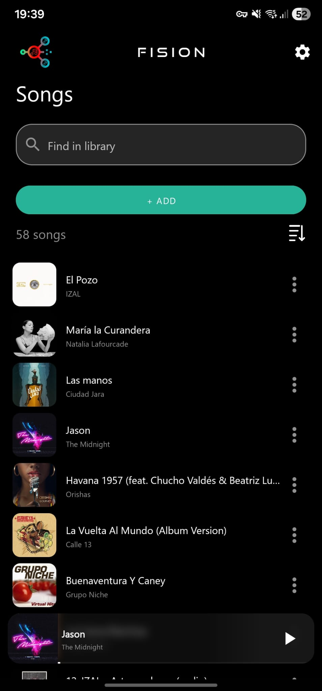
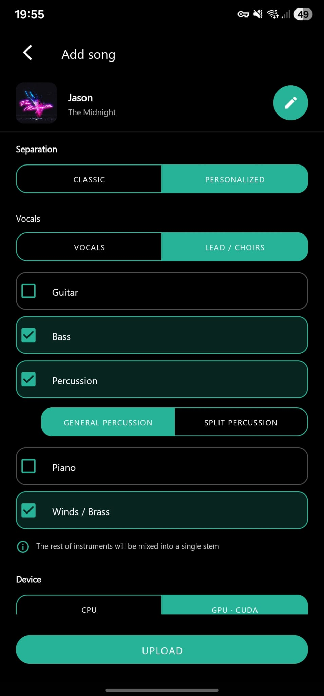
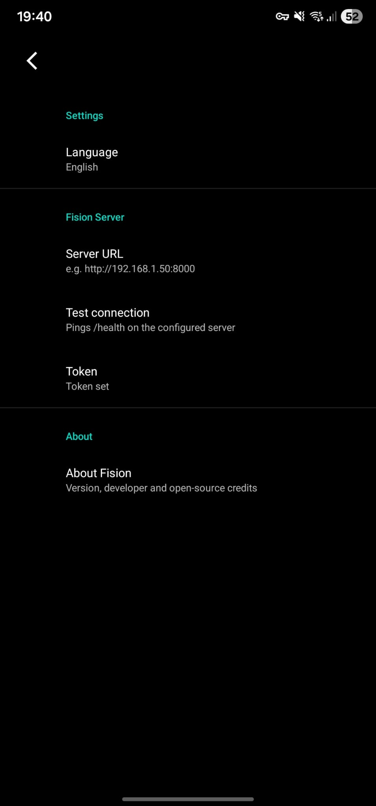
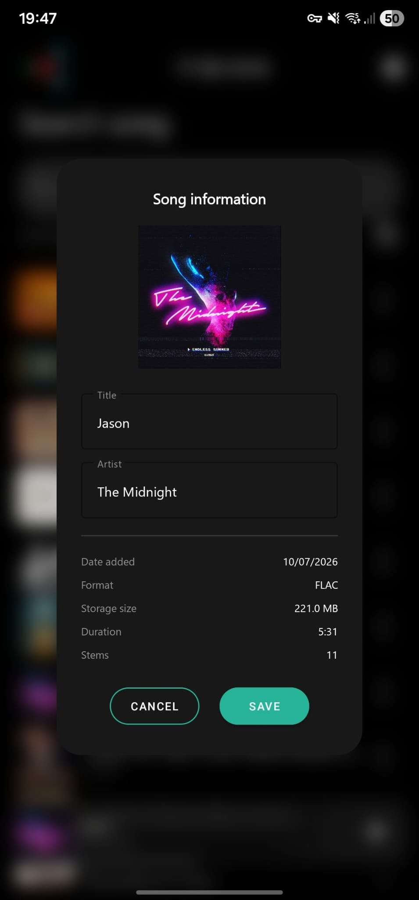
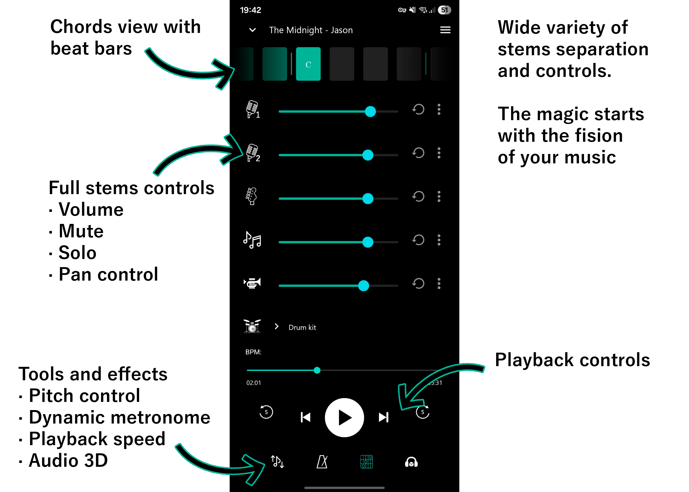
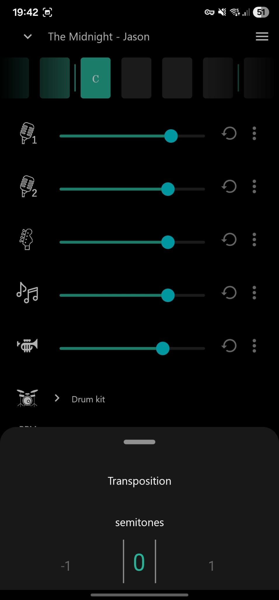
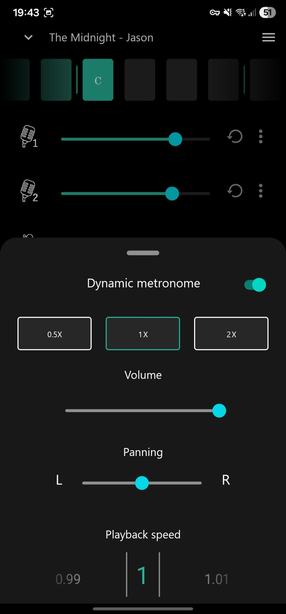
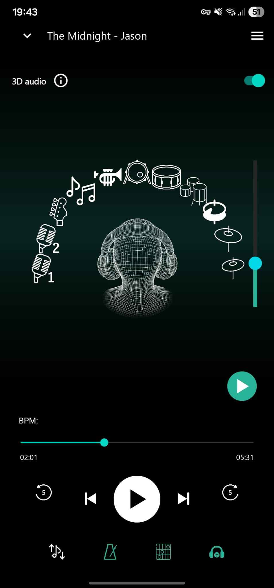

# Fision Android

Android client for the Fision ecosystem. Plays multitrack songs prepared by the
Fision server as separate stems (vocals, drums, bass, other, and any extras the
server exposes) and lets you remix them, transpose, retempo, follow chord
charts, run a dynamic click, and place each stem in 3D space around the
listener.

## About the Fision ecosystem

Fision is a self-hosted setup for musicians and music lovers who want to turn
any track into a playable, remixable session. The umbrella repository at
[jotapemj/Fision](https://github.com/jotapemj/Fision) lists the pieces that make
up the ecosystem. In short:

- **FisionServer**: FastAPI service that runs audio separation, chord
  detection, beat and downbeat estimation, and packs everything into a
  ZIP consumed by this app.
- **FisionApp Android** (this repository): the Android front-end. Uploads
  audio, tracks the processing job, downloads results, and plays them back
  through a native C++ engine.

The magic starts with the fision of your music.

## Features

- Native multitrack player with sample-accurate stem mixing.
- Real-time pitch shift and tempo change.
- Chord charts synced to bars and downbeats, in American or Latin notation,
  with flats or sharps.
- Dynamic metronome that follows the song's own beat grid.
- Per-song stem panning and volume, remembered across launches.
- Downbeat click with configurable sample.
- 3D audio positioning per stem using HRTF convolution.
- Cloud processing: pick a local file, choose the separation model, and get
  the stems back automatically.
- Song library with sort, search, edit, and delete.
- Export the current mix or individual stems to WAV, AAC, or M4A.
- Background playback with Bluetooth and notification controls.

## The song library




The main screen lists every song stored locally plus any
song that lives on the Fision server. Each entry shows its cover, title,
and artist. Server-only songs appear alongside local ones ordered by
submission date. Songs currently being processed show a spinner over the
cover with a status subtitle. Songs being downloaded show a wave
animation over the cover growing from bottom to top.

### Importing a song



The import flow lets you pick any audio file on the device through the
system picker and choose the separation configuration to send to the
server. There are two paths:

- **Classic presets**: 2-stem or 4-stem separation.
- **Personalized**: enable or disable individual stems (guitar, bass,
  drums, piano, brass) and choose voice mode (single or split).

You also pick the compute device (CPU or CUDA). The audio is streamed
to the server without loading the whole file into memory, and a
progress dialog shows the upload percentage with a cancel button.

Chord detection on the server always uses BTC (Bidirectional
Transformer for Chord recognition), so there is no chord backend
selector in the app.

### Server connection



The Settings screen holds the server URL and the bearer token. The URL
is a plain preference. The token is stored in an encrypted preferences
file and unlocked by biometric authentication before it can be shown or
edited. A dedicated test button pings the server with a 5 second timeout
and reports success or failure. The status icon in the toolbar of the
main screen mirrors the connection state.

### Cloud processing states

While the server is working, the corresponding song entry cycles through
these states in the UI:

- **Queued**: waiting in the server queue. The subtitle shows the queue
  position when known.
- **Running**: the server is processing.
- **Downloading**: the ZIP is being fetched, with a percentage overlay
  and a wave animation on the cover.
- **Cloud only**: available on the server, not yet downloaded. Tap to
  download.
- **Local and cloud**: available on the device and on the server.
- **Local only**: on the device only. Songs you added manually behave
  this way.
- **Error** or **Cancelled**: shown as a static overlay with a status
  label.

Downloads run inside a foreground service with its own notification, so
they survive leaving the app.

### Song bottom sheet


Long-pressing a song opens a bottom sheet with the cover in HD, the
title, the artist, and two actions:

- **Edit info**: opens the edit dialog described below.
- **Delete**: removes the song. If the song exists both locally and on
  the server, the local files are removed and the entry stays as
  cloud-only. A second delete pass removes it from the server too.

### Edit info dialog



The edit dialog lets you rename the song, set the artist, and shows a
read-only information block with details of the underlying files:

- Date added.
- Audio format (WAV, FLAC, or both).
- Total size on disk.
- Duration.
- Number of stems detected.

### Sort by

The list can be sorted by date added, ascending or descending. The
preference is remembered and reused by the mini player when the user
swipes to the previous or next song.

### Search

The search bar filters the list by folder name, display title, and
artist. Any local metadata written by the server or edited from the app
is used as a match target.

## Player



The player screen is the main working surface. From top to bottom and
side to side you find:

- **Chord section with bars**: a horizontal strip of beat cells that
  scrolls in sync with the song. Each cell shows the chord that plays at
  that beat when available. Bar lines are drawn at each downbeat.
- **Stem controls**: one row per stem, with an icon that toggles mute,
  a volume slider, a restore button that animates the slider back to
  the default value, and a menu button that opens the stem bottom
  sheet.
- **Playback controls**: play and pause, seek bar, previous and next
  song buttons, and 5 second jump buttons.
- **Pitch button**: opens the pitch bottom sheet.
- **Metronome button**: opens the dynamic metronome bottom sheet.
- **Show/hide chords button**: collapses the chord section to give the
  stem list more room.
- **Audio 3D button**: switches into the 3D positioning view.

## Song folder layout

Each song lives in its own folder inside the app's `Songs/` directory
on external storage. Folders downloaded from the server are named
after the hash the server assigns; folders you add manually can use
any name, and the app treats them as local-only.

A typical folder contains:

```
SongName/
├── bass.flac
├── drums.flac
├── other.flac
├── vocals.flac
├── (extra stems the server may produce, such as guitar, piano,
│    brass, kick, snare, toms, hh, ride, crash, vocals2)
├── metronome.flac
├── metronome_half.flac
├── metronome_double.flac
├── chords.txt         (advanced chord chart, one "CHORD TIME" per line)
├── chords_basic.txt   (optional, basic variant of the chord chart)
├── beats.txt          (first line: global BPM, then one beat time per line)
├── downbeats.txt      (optional, one downbeat time per line)
├── metadata.txt       (optional, "Title: ...", "Artist: ...")
└── artcover.png       (optional, HD cover for the notification and UI)
```

Stems can be WAV instead of FLAC (see the note above about stem
formats). The app matches stems by filename (case-insensitive, without
the extension) against its internal catalog, so any WAV or FLAC whose
name matches a known stem name is loaded automatically. Files that do
not match a known stem are ignored.

### Files securities

If a song is missing `chords_basic.txt`, the drawer disables the
Chords toggle and the advanced variant is used by default. If a song
is missing `downbeats.txt`, bar lines are inferred from the beat grid
using the global BPM. If a song is missing `metadata.txt` or
`artcover.png`, the folder name is used as the title and a generic
cover is shown.

## Audio engine

The audio engine is written in C++ and built on top of
[Oboe](https://github.com/google/oboe), Google's low-latency audio
library for Android. A single audio stream drives all stems, which means
every stem is mixed sample by sample in the same callback and therefore
always in phase.

Pitch shifting and tempo change use
[SoundTouch](https://www.surina.net/soundtouch/) (LGPL) with its WSOLA
algorithm. To keep every stem in phase when the user changes pitch or
tempo, SoundTouch runs on every stem all the time, even when the pitch
and tempo are at defaults. This avoids the phase drift that would appear
if some stems went through WSOLA and others did not.

FLAC decoding is handled by
[dr_flac](https://github.com/mackron/dr_libs/blob/master/dr_flac.h)
(MIT / Public Domain).

### Stem file format

By default stems are stored as FLAC. The server transcodes its output
to FLAC before packing the ZIP, so downloads land as `bass.flac`,
`drums.flac`, and so on. The app also accepts stems in WAV, in case the
server is configured to skip the FLAC pass. WAV files are lossless too
but roughly five times larger than the FLAC equivalent. WAV is useful
when the source is already high quality and disk space is not a
concern. It brings no benefit when the input is a lossy MP3.

## Player drawer


The drawer on the right side of the player exposes global and per-song
options.

- **Chords**: switches between the basic and the advanced chord chart
  when the song was processed with both variants. Disabled when only
  one variant is available.
- **Chord notation**: American (C, D, E) or Latin (Do, Re, Mi). This
  also swaps the font used to render the chord glyphs.
- **Accidentals**: displays sharps or flats when transposing.
- **Transpose with pitch**: when enabled, the chord chart is transposed
  in real time to match the current pitch shift.
- **Sound on downbeat**: adds a click on the first beat of each bar.
  When enabled, a submenu lets you pick which sample to use for the
  click.
- **Reset to default**: resets every stem volume to 75, every stem pan
  to 0, and exits solo mode if active. Pitch, tempo, and metronome
  settings are left untouched.
- **Reprocess**: reopens the import activity prefilled with the current
  configuration and lets you re-run the pipeline on the same input
  file with different options. When the server finishes, the new ZIP
  replaces the old stems on disk.
- **Export**: opens the export wizard. You can export the current mix
  or the stems individually. Supported formats are WAV (PCM 16 stereo),
  AAC (raw with ADTS headers), and M4A (AAC LC in an MP4 container).
  When exporting the mix, the metronome and the current stem volumes
  can be included optionally.

## Stem bottom sheet

Tapping the menu button on a stem opens its bottom sheet. From here you
can:

- Set the stem pan from left to right.
- Solo or unsolo the stem.
- Export the stem on its own, choosing the target format.

## Pitch bottom sheet



The pitch bottom sheet lets you transpose the song in semitones. The
range covers a comfortable interval around the original key. 
[!NOTE]
The stem`drums` is excluded from pitch shifting on purpose, 
so the drum kit never sounds detuned. The rest of the stems are
pitched by SoundTouch, which drives the WSOLA algorithm mentioned above.

## Dynamic metronome bottom sheet



The metronome is dynamic. It is generated from the song's own beat grid
during processing on the server, so it follows tempo changes and swing
inside the song with high precision.

The bottom sheet offers three subdivisions:

- **1x**: one click per beat.
- **0.5x**: one click every two beats. Useful for slower feels or
  half-time practice.
- **2x**: two clicks per beat. Useful for eighth-note grids.

[!NOTE]
For songs where the 0.5x click lands on beats 2 and 4 instead of 1 and
3, the 0.5x option expands into two variants (A and B). Variant A uses
the phase from the server. Variant B shifts the click by one beat
interval computed locally from the beat grid, which lets it adapt to
tempo changes within the song.

## Pan and playback speed

Stem pan is applied by the C++ engine as a per-channel gain on the
mix. Playback speed uses SoundTouch's tempo control, decoupled from
pitch. You can slow the song down without pitching the vocals or the
instruments.

## Audio 3D



The 3D view places each stem as a movable icon around a virtual head.
It uses HRTF (Head-Related Transfer Function) convolution with a
128-tap impulse response per ear, built from the KEMAR MIT dataset. The
result is a convincing 3D image over headphones. Elevation is also
supported through bilinear interpolation between azimuth and elevation
slices of the dataset. When the HRTF binary is not present, the engine
falls back to a synthetic ITD (interaural time difference) plus ILD
(interaural level difference) approximation.

The interface offers:

- **Drag** any stem icon to position it around the head. Distance from
  the head maps to perceived distance, and the icon scales up close
  and shrinks far away.
- **Tap** an icon to select it. The elevation slider on the side
  applies to the selected stem.
- **Double tap** an icon to toggle omnipresent mode for that stem. In
  this mode the stem keeps HRTF filtering for its natural spatial
  color but drops the directional cues.
- **Long press** an icon to mute or unmute the stem.
- **Reset** button to send every stem back to its default frontal
  semicircle.

There is also a **dance** mode. When enabled, the selected stems orbit
the head in the XY plane at slightly different speeds so they do not
move as a block. Two inline sliders let you adjust orbit speed and
distance while the dance is running. Dragging a stem out of the orbit
lets you place it manually, and releasing it snaps it back to the
dance at the new radius. Recommended for headphone listening. Speaker
playback loses most of the 3D cues.

## Persistence

Every per-song setting is written to a local Room database (SQLite):
per-stem volume and pan, mute, solo, pitch, tempo, metronome subdivision
and volume, chord chart variant, downbeat click state, 3D mode on or
off, and 3D position and elevation per stem. When you reopen a song,
everything is restored exactly as you left it. Migrations are
non-destructive between versions.

Global preferences that do not belong to a single song (chord notation,
sort order, downbeat sample choice, and so on) live in `SharedPreferences`.

## Mini player and background service

Audio playback lives in a foreground `Service`. That means the player
keeps running when you leave the app, when the screen turns off, and
when you jump to a different task. It exposes a `MediaSession`, so the
usual controls work everywhere:

- The system notification with play, pause, previous, and next.
- Bluetooth headset buttons.
- Car head units and lock-screen media controls.

The main screen shows a mini player at the bottom whenever a song is
loaded. Tapping it opens the full player. Swiping left or right on it
moves to the previous or next song, with a live preview of the target
song as your finger drags.

## Building

The project is a standard Android Studio module with Gradle. It
requires the Android NDK (for the C++ engine) and CMake. Open the
project in Android Studio, let Gradle sync, and run the `app`
configuration on any device with Android 7.0 (API 24) or higher.

## Credits and citations

Fision Android relies on the work of several open-source projects and
research datasets. Please respect their licenses if you reuse code
from this repository.

### Audio and DSP

- **Oboe**. Google's low-latency audio library for Android.
  Apache License 2.0.
  <https://github.com/google/oboe>
- **SoundTouch**. Real-time pitch shifting and tempo change.
  LGPL 2.1.
  <https://www.surina.net/soundtouch/>
- **dr_flac**. Single-file FLAC decoder by David Reid (mackron).
  MIT / Public Domain.
  <https://github.com/mackron/dr_libs>

### HRTF dataset

- **KEMAR HRTF measurements**. Bill Gardner and Keith Martin, MIT
  Media Lab, 1994. Free for research and personal use.
  <https://sound.media.mit.edu/resources/KEMAR.html>

  > Gardner, W. G., and Martin, K. D. (1995). "HRTF measurements of
  > a KEMAR." Journal of the Acoustical Society of America, 97(6),
  > 3907-3908.

### Android libraries

- **AndroidX** and **Material Components**. Apache License 2.0.
- **Room**. Apache License 2.0.
- **OkHttp** and **Retrofit**. Apache License 2.0.

### Server-side pipeline

The following tools run on FisionServer, not inside this app. They are
listed here so that users of the ecosystem can attribute them
properly:

- **Demucs** and **BS-RoFormer** (via audio-separator). Source
  separation models used to produce stems.
- **BTC (Bidirectional Transformer for Chord recognition)**. Chord
  detection.
- **beat_this**. Beat and downbeat estimation.

## License

TBD. Add a `LICENSE` file at the root before making the repository
public.
