# Fision user guide

How to use each part of the app and its features. For the overview, installation and credits see the [README](../README.md). For the engine and file formats see the [technical notes](TECHNICAL.md).

- [Connecting to the server](#connecting-to-the-server)
- [The song library](#the-song-library)
- [The player](#the-player)
- [Lyrics](#lyrics)
- [Audio 3D](#audio-3d)
- [Exporting](#exporting)
- [Playback outside the app](#playback-outside-the-app)
- [Android Auto](#android-auto)

## Connecting to the server

  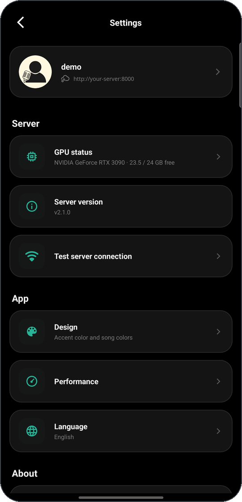

Fision separates songs on a self-hosted
[FisionServer](https://github.com/jotapemj/Fision-Server). On the first launch a
login dialog asks for the server address, username and password.

**Local mode** skips it: the player then works fully offline with song folders copied to the device by hand, for when there is no server or no connection to it. Until it is in the library, local mode lists the demo song pinned on top with a dark cover: tapping it downloads it from GitHub and imports it, with the progress on the cover and in a notification. Deleting the imported song brings the dark entry back; deleting the dark entry hides it, and **Settings → About → Download demo song** offers it again. The manual steps are in [Try it without a server](../README.md#try-it-without-a-server).

Once signed in, the session token is stored encrypted, sent only to the
configured server and left out of Android backups. If the address is plain
HTTP outside Tailscale or the device itself, the login dialog warns that the
password and songs would travel unencrypted. A cloud icon in the toolbar
shows whether the server is reachable.

The **Account** row in Settings lets you:

* **Change password**, after biometric or screen lock confirmation.
* **Switch account.**
* **Log out**, which clears the session and the cached data of that user.

Settings also has a connection test and a **GPU** row with the server's
graphics card, total and free memory. When the server is low on GPU memory,
a warning icon appears in the toolbar.

### Profile picture

  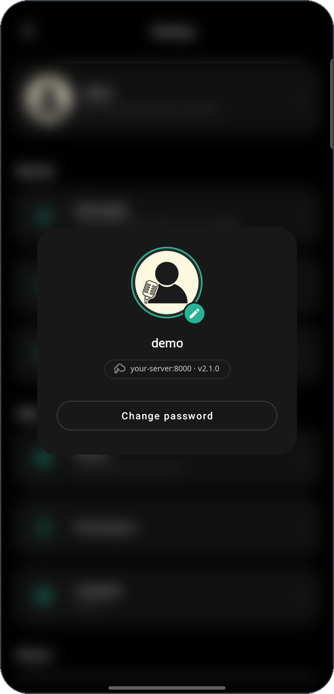

From the Account dialog, the profile picture can be changed. The selected
picture is uploaded as a 512×512 JPEG.

## The song library

  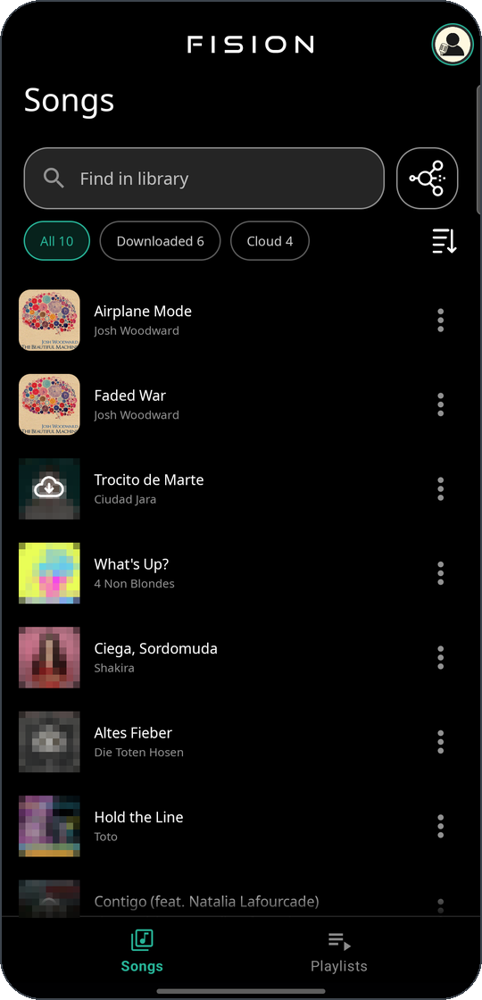
  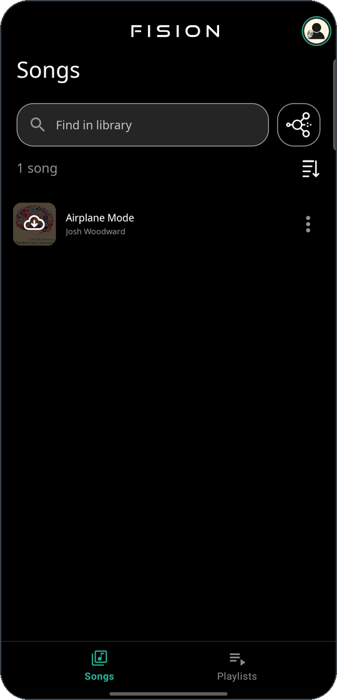

The main screen has two tabs, **Songs** and **Playlists**. The song list
mixes songs on the device and songs on the server.

### Adding a song

  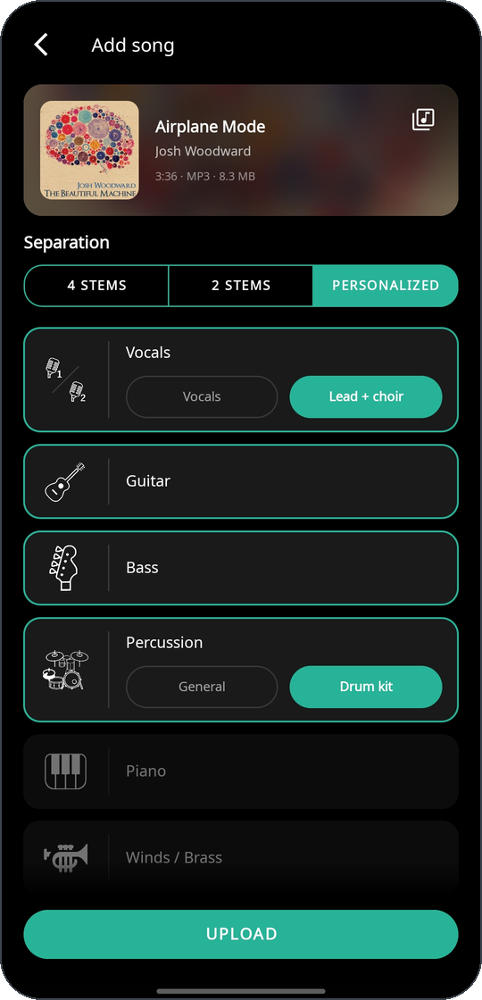

The add button picks an audio file from the device storage.

> [!NOTE]
> A song can also be shared directly to Fision from other apps.

Then pick the separation:

* **Classic presets**: 4 stems (vocals, drums, bass, other) or 2 stems
    (vocals and the rest).
* **Custom**: choose the stems one by one. The stems currently available through *audio-separator* are:
    * Vocals
        * Mixed vocals
        * Main vocals + Chorus vocals
    * Bass
    * Drums
        * Full percussion
        * Split drums (snare, kick, toms, hi-hat, crash and ride)
    * Piano
    * Guitar
    * Brass

The server runs the job on its GPU when it has one; otherwise the screen
warns that it will take longer on the CPU.

> [!NOTE]
> Separating on the CPU takes much longer than on the GPU.

> [!WARNING]
> Empty files, clips under 15
> seconds, unsupported formats and files over 200 MB are rejected before
> uploading.

### Processing states

While the server works, the song shows its state over the cover:

* **Queued**, with its position in the queue.
* **Running**.
* **Waiting for GPU**. Shown when the GPU has less free memory than the minimum configured on the server. If the GPU stays busy too long, a dialog offers to retry with the same setup before detaching the job.
* **Downloading**.
* **Cloud only**: song on the server, not downloaded yet. The cover is
    dimmed with a cloud and a download arrow; tap to download.
* **Error** or **Cancelled**. A downloaded song whose reprocess failed stays
    playable with its previous stems.

> [!NOTE]
> Downloads run in a foreground service and continue outside the app.

### Song options

Long-pressing a song opens its options:

* **Retry processing** after a reprocess that failed for a temporary
    reason.
* **Edit info**: title and artist, date added, audio format, size, duration and number of stems.
* **Delete**: 2 levels of deletion. The first delete removes the local files and keeps the song
    on the server; deleting again removes it from the server too.

### Playlists

  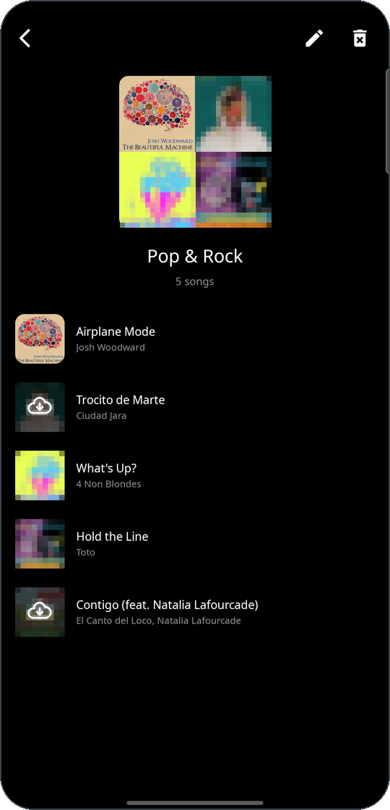

Playlists are stored on the server and copied to the device, so they play
without a connection. Creating or editing them needs the server, which keeps them in sync.
Each playlist can be customised:

* Title
* Custom cover, or a mosaic of its songs
* Order

Songs not downloaded show the same cloud on their cover. Tapping one
downloads it, and the cover fills up as the download progresses, as in the
library.

### Sorting and search

  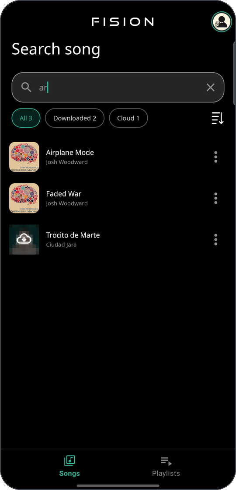

The list sorts by date added, newest or oldest first, and keeps the same
order online, offline and at startup. The search bar filters by title or artist.

When the library has both downloaded songs and songs only on the server,
filter chips replace the song count: **All**, **Downloaded** and **Cloud**,
each with its number. The search works inside the selected chip.

## The player

  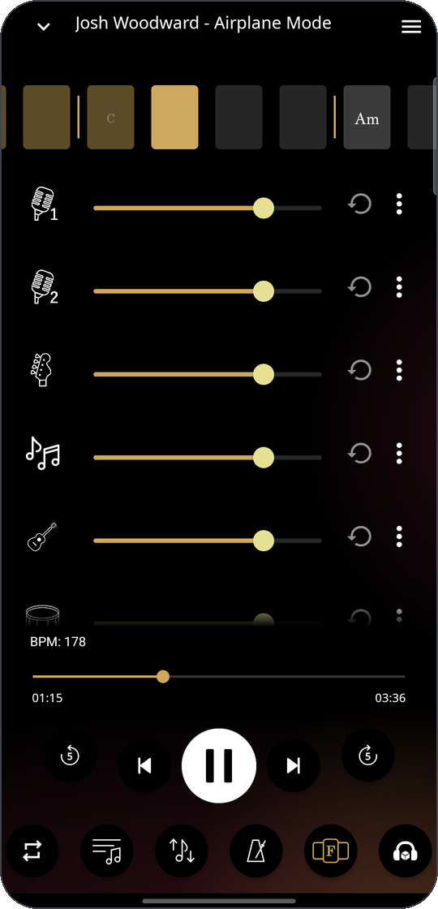

From top to bottom:

- **Chord strip**: one cell per beat with the chord that starts there and
  bar lines at each downbeat.
- **Stems**: one row per stem with icon (**solo** and **mute** options availables), volume slider,
  restore button and options button. 
- **Controls**: play and pause, seek bar, previous and next, and 5 second
  jumps. Typical player controls.
- **Bottom bar**: buttons for repeat modes, pitch, metronome and speed adjust,
  chords, lyrics and 3D audio scene.

### Chords and chord diagrams

  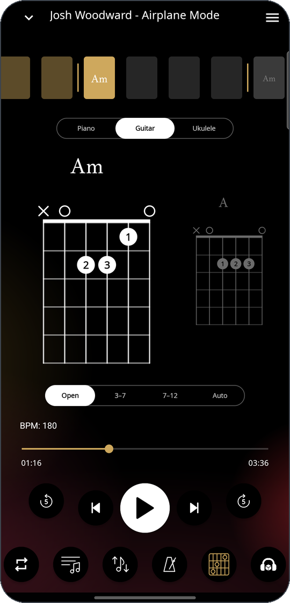
  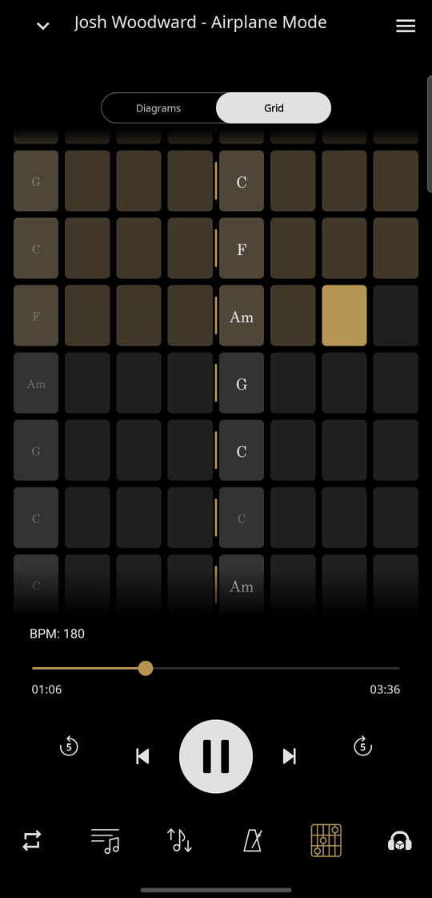

The chords button from the bottom bar unfolds into two entries 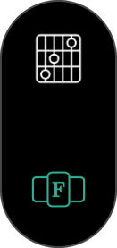 :
one shows or hides the **chord strip**, the other opens the **chord diagrams** , the current and the next
chord for piano, guitar or ukulele. Guitar and ukulele have a fret zone
selector (open, 3-7, 7-12 or automatic, which keeps the hand close to the
previous chord). Swiping the diagrams jumps to the next or previous chord.
A pill at the top switches between **Diagrams** and **Grid**: the grid shows
the whole song, one cell per beat and two bars per row, follows the playback
and jumps to a chord when tapped. Opening lyrics or 3D from the diagrams brings them back when that view is
closed.

From the drawer: basic or advanced chart (when the song has both),
American (C D E) or Latin (Do Re Mi) notation, sharps or flats, and
whether the chords follow the pitch shift.

### Solo and mute

Tapping a stem's icon opens **Solo** and **Mute**. Mute sets the slider to
0. Several stems can be soloed at once, and the icon of the drum kit header
solos all its parts together. The other stems go silent without moving
their sliders, which keep working; removing the last solo brings every stem
back at its current level. Solo is not saved and clears when another song
loads.

### Stem options and effects

  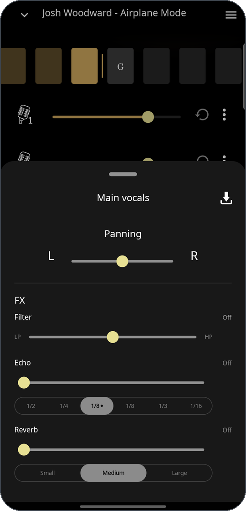

The options button of a stem opens its sheet: pan, export of that stem,
and three effects:

- **Filter**: one slider, low-pass to the left (20 kHz down to 200 Hz) and
  high-pass to the right (20 Hz up to 15 kHz); the centre is off.
- **Echo**: amount and a beat division (1/2, 1/4, dotted 1/8, 1/8, eighth-note triplet, 1/16)
  that follows the song tempo, also with speed changes.
- **Reverb**: a send into a small, medium or large room shared by all
  stems.

Effects are not saved; they reset when another song loads.

### Pitch

  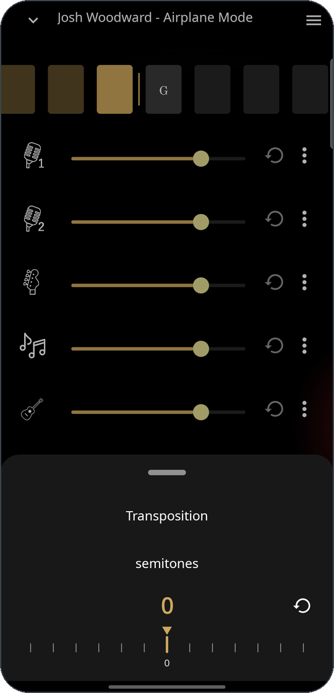

The pitch sheet transposes in semitones on a ruler with snap and haptic
ticks; the original key is the highlighted tick and the restore button
returns to it.

> [!NOTE]
> The drums stem is never pitched, so the kit does not sound detuned.

### Dynamic metronome and speed

  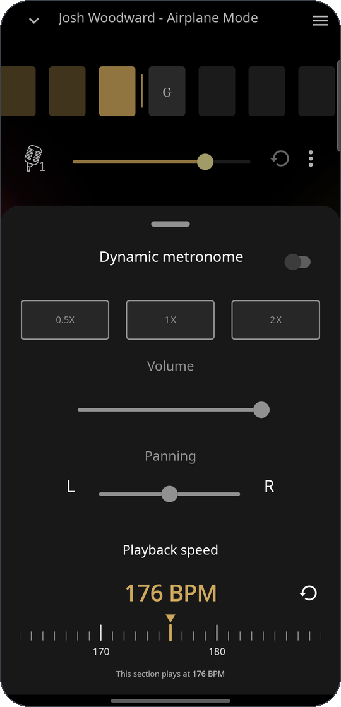

The click is generated on the server from the song's own beats, so it
follows tempo changes and swing. A pill picks the subdivision; the A / B
pill appears below it only with 0.5x:

- **1x**: one click per beat.
- **0.5x**: every two beats, with variants A and B when the default lands
  on beats 2 and 4.
- **2x**: two clicks per beat.

A separate option in the drawer plays a sample on every downbeat.

The speed ruler works in BPM when the song has a detected tempo (otherwise
in 0.05× steps), marks the original tempo and shows the local BPM when the
current section differs from the average. Speed changes never change the
pitch.

### Drawer

  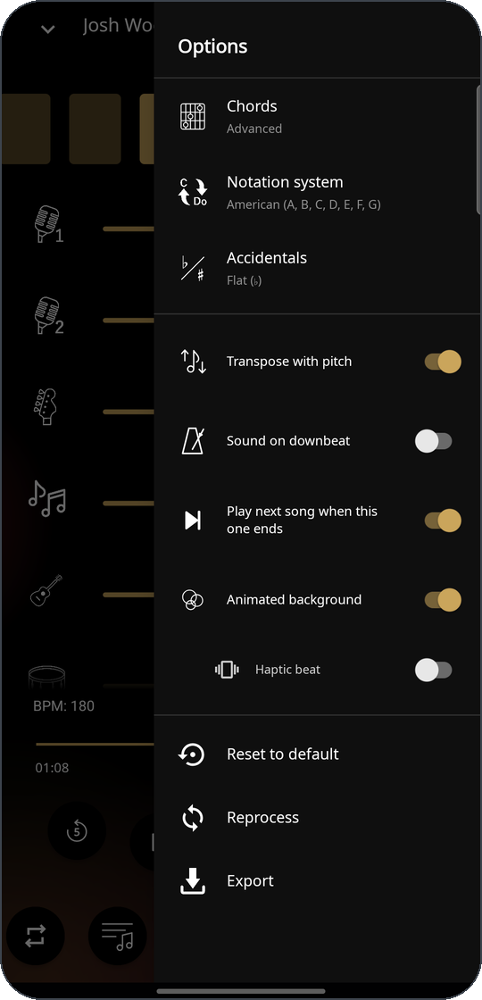

Besides the chord options above, the drawer has:

- **Play next song**: continues with the next song when repeat is off, also
  with the app in the background or the screen off.
- **Sound on downbeat**, with a choice of samples.
- **Reprocess**: runs the song again on the server with another separation.
- **Reset to default**: volumes to 75, pan centred, solo off, pitch 0,
  tempo 1x, metronome off and 3D off.
- **Export**: see [Exporting](#exporting).

### Animated background

An optional ambient background: soft shapes in the colours of the current
cover that pulse on the beat, at half time above 130 BPM. The pulse follows
the energy of the drums: it rests in quiet sections and fades in over the
beats that lead to a loud one. Songs without clear contrast between sections
pulse throughout. The first time a song opens with the background on, the
drums are measured in the background and the result is saved with the song.
A sub-option adds **haptic beat**, vibrating with the same pulses while the
player is on screen (up to about 140 pulses per minute).

## Lyrics

  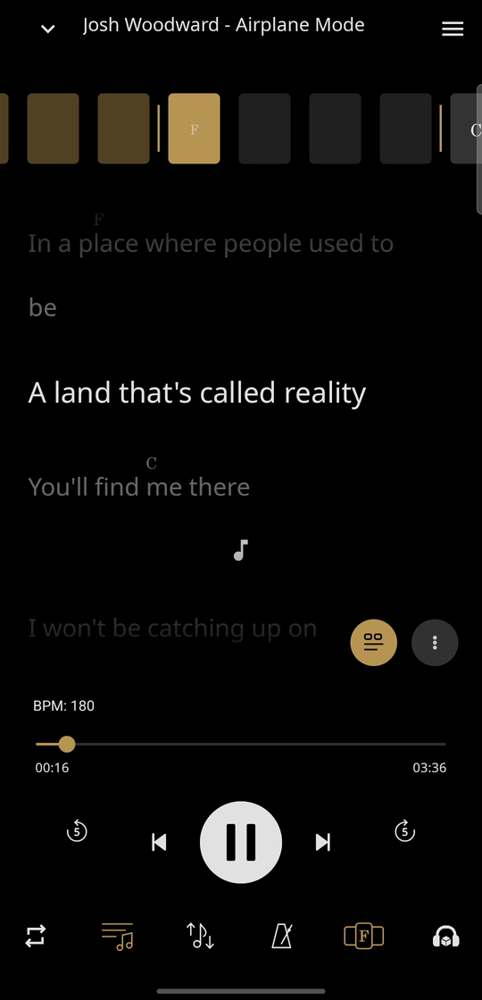

The lyrics button asks the server to transcribe the song, in an automatic
or chosen language (27 options). Once ready, the lyrics are cached on the
device. Lyrics the server already has (made on another device, or before
the song was downloaded again) are fetched when the song opens.

Lines follow the singer: the app measures where the voice really sounds on
the separated vocal stems, so each line and word lights when it is sung,
held notes stay lit and the instrumental marker appears only in real vocal
silence. An optional **karaoke** mode lights every word as it is sung.
Tapping a line or word jumps there, also while paused.

Dragging down through the lyrics folds the controls into a pill with the
transport row and a lit button to close the view. Dragging back up, or
reaching the top, unfolds them.

When the song has chords, a button next to the options shows the **chords
above the words**, placed where each chord starts and following the chord
options (chart, notation and pitch). It is saved per song.

## Audio 3D

  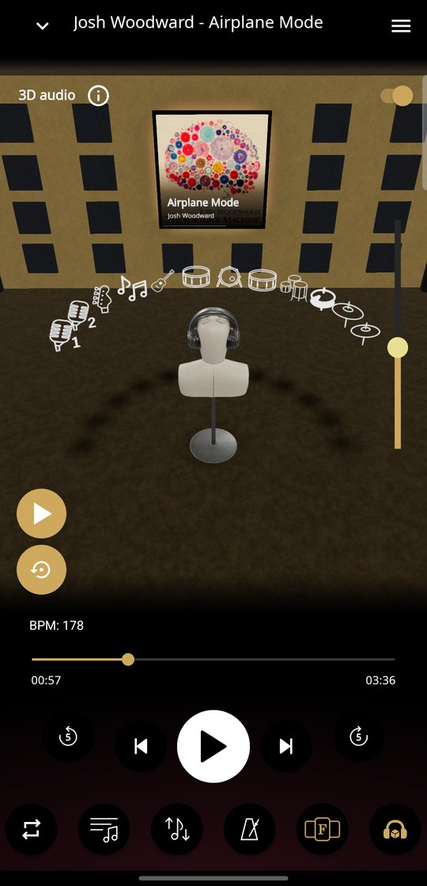
  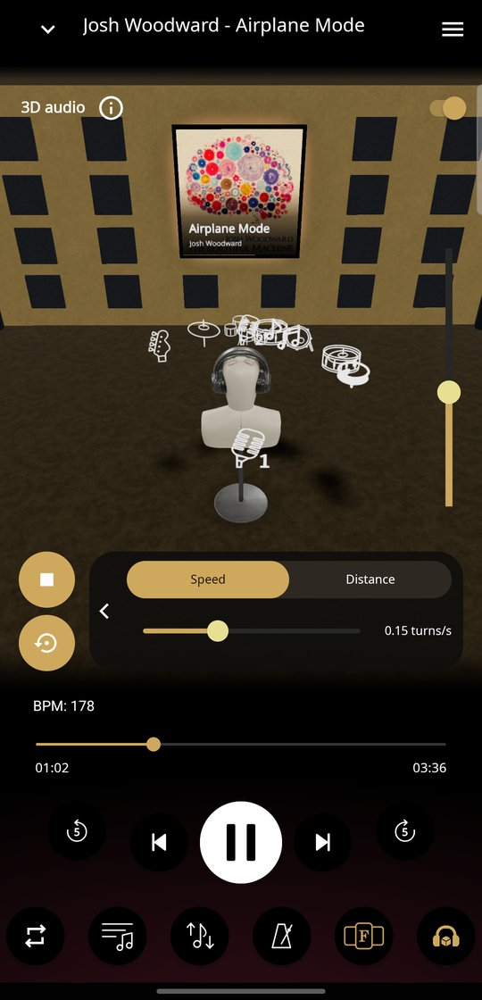
  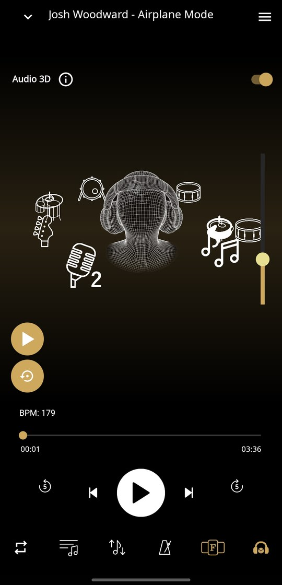

The 3D view places every stem around your head using HRTF, for a real
spatial image over **headphones**:

- **Drag** a stem to move it; distance changes its loudness.
- **Tap** to select it and set its height with the side slider.
- **Double tap** to make it omnipresent (no direction).
- **Long press** to mute it.
- **Reset** stops the dance and returns every stem to the front.

**Dance** mode makes the chosen stems orbit the head, each at its own
speed and optionally swinging up and down, with sliders for speed and
distance.

The **flat view** looks at the head from behind: stems in front of the
listener are smaller and pass behind the head, stems behind it are larger
and pass over it, and height moves a stem up and down.

**Scene mode** (Settings, Performance) shows a 3D studio room instead of
the flat view, with the listener in the middle and one sprite per stem;
drag to orbit the camera and pinch to zoom.

While 3D is on, the volume sliders are locked: distance sets the level,
and leaving 3D restores the sliders as they were.

## Exporting

  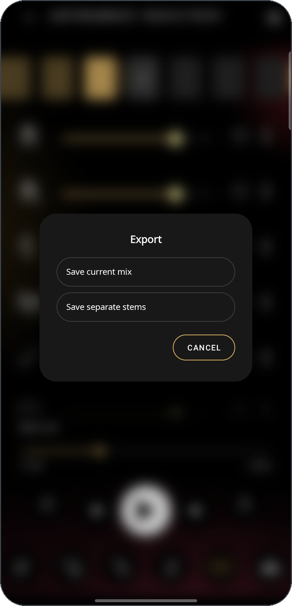

From the drawer you can export the current mix or every stem separately;
each stem's sheet exports that stem alone. Formats: WAV (16-bit stereo),
AAC and M4A. The mix can use the default or the current volumes and
include the metronome. When stems have effects on, **Include effects**
renders them with their full echo and reverb tail. The export ignores any
solo and warns about it first. Files are saved to
`Music/Fision/<Artist - Title>/` in the device storage.

> [!NOTE]
> Pitch and speed are not applied to exports.

## Playback outside the app

Playback keeps going when you leave the app or turn the screen off, with
controls in the notification, the lock screen and Bluetooth devices. The
library shows a **mini player** while a song is loaded: tap it to open the
player, or swipe it to change song with a live preview.

## Android Auto

Fision appears as a media app in Android Auto with the songs downloaded on
the phone. In the car every stem plays at its default level with the
original pitch and tempo. Two buttons mute the lead vocals (karaoke) and,
when the song has them, the backing vocals, with a short fade. Nothing is
saved, and the car never starts playback on its own.

  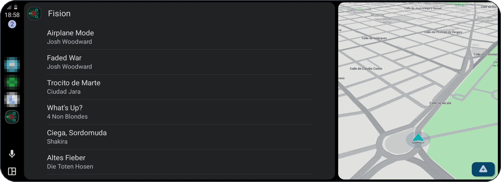
    
  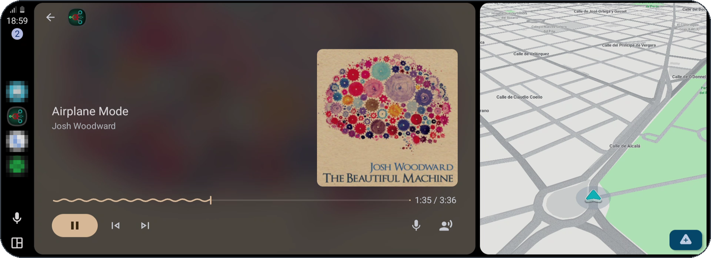

